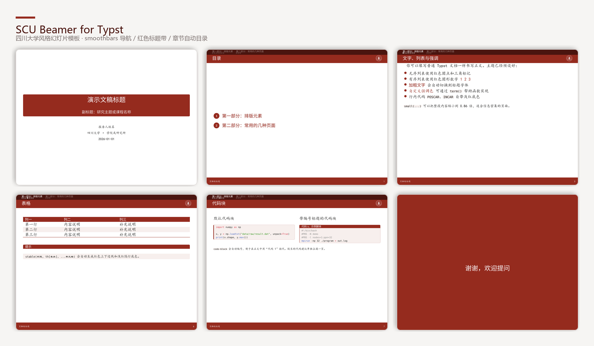
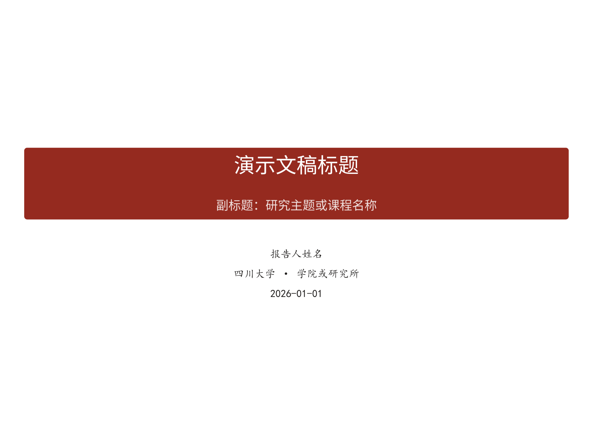
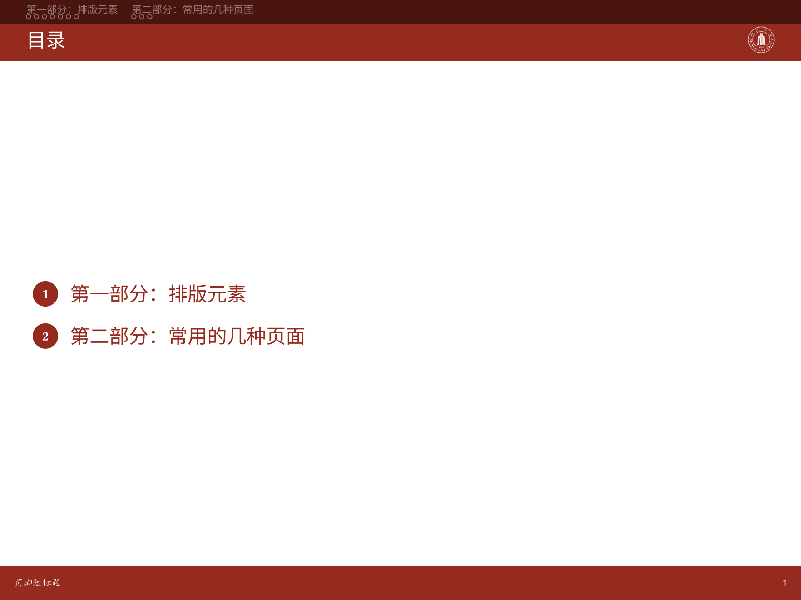
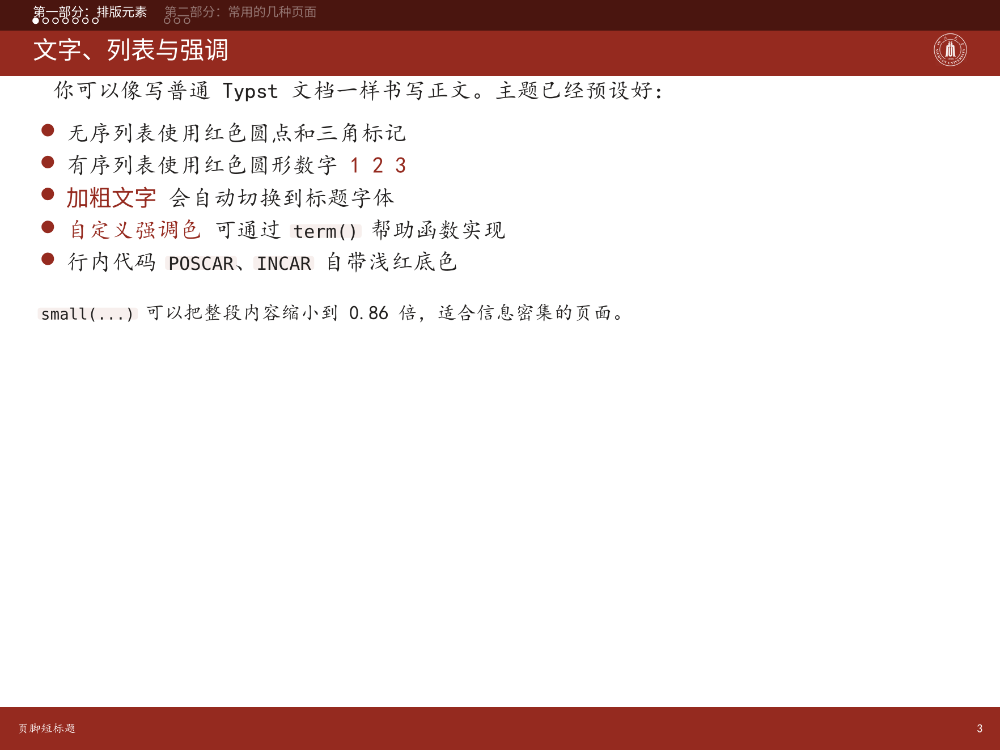
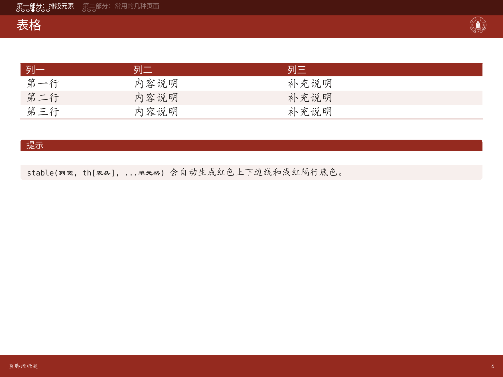
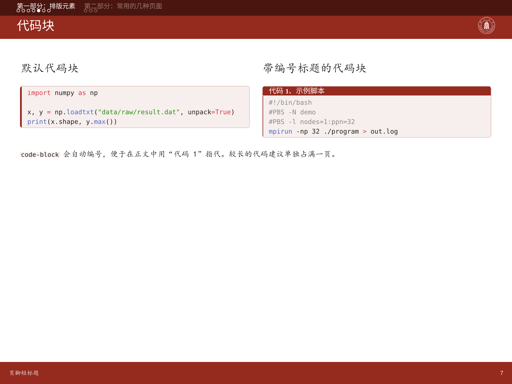

# SCU Beamer for Typst

四川大学风格的 [Typst](https://typst.app) 幻灯片模板，基于 [Touying](https://github.com/touying-typ/touying) 0.7.4，
对标的视觉风格是 LaTeX 的 `beamer` + `SCU.sty` 主题。

A Sichuan University (SCU) presentation theme for Typst, built on Touying 0.7.4.



## 效果预览

<table>
<tr>
<td width="33%" align="center"><br><sub>封面与标题信息</sub></td>
<td width="33%" align="center"><br><sub>自动生成的目录</sub></td>
<td width="33%" align="center"><br><sub>文字、圆形列表与红色强调</sub></td>
</tr>
<tr>
<td width="33%" align="center"><br><sub>红色表头的斑马线表格</sub></td>
<td width="33%" align="center"><br><sub>自动编号的代码块</sub></td>
<td width="33%" align="center"><br><sub>全屏结束页</sub></td>
</tr>
</table>

> 以上图片由 `main.typ` 直接渲染生成，可用 `python tools/make-preview.py` 重新生成。

## 特性

- **smoothbars 导航条**：顶部深红条显示各章节标题与逐页圆点进度，可直接点击跳转
- **红色 frame-title 色带**：每页幻灯片标题，右侧可放校徽
- **两行式页脚**：显示短标题与幻灯片页码，不计入封面和结束页
- **章节自动目录页**：每个一级标题前自动插入一张高亮当前章节的目录
- **Beamer 风格区块**：`titled-block` / `example-block` / `alert-block`
- **科研汇报常用组件**：带编号的 `code-block`、`stable` 斑马线表格、`pill`/`arr` 流程图元、`focus-slide` 结束页
- **中文字体回退**：Windows / macOS / Linux 都能直接编译（见下文「字体」）

## 快速开始

### 1. 获取模板

```bash
git clone https://github.com/<你的用户名>/typst-scu-beamer.git
cd typst-scu-beamer
```

### 2. 编译

```bash
typst compile main.typ          # 生成 main.pdf
typst watch main.typ            # 保存时自动重新编译
```

也可以在 [Typst Web App](https://typst.app) 中新建项目，把 `lib.typ`、`main.typ` 与 `assets/` 一起上传。

> 首次编译需要联网，Typst 会自动下载 `@preview/touying:0.7.4`。

### 3. 换成本身的内容

`main.typ` 里所有文字都是占位示例，直接改写即可。骨架如下：

```typ
#import "lib.typ": *

#show: scu-theme.with(
  aspect-ratio: "4-3",          // 或 "16-9"
  config-info(
    title: [演示文稿标题],
    short-title: [页脚短标题],
    subtitle: [副标题],
    author: [报告人姓名],
    institution: [四川大学 · 学院或研究所],
    date: datetime(year: 2026, month: 1, day: 1),
  ),
)

#title-slide()      // 封面
#outline-slide()    // 总目录

= 第一章             // 一级标题：自动插入章节目录页
== 第一页标题         // 二级标题：一页幻灯片

正文……

#focus-slide[谢谢，欢迎提问]
```

### 关于标题栏的校徽

`scu-theme` 的 `logo` 参数**默认就是 `assets/scu-logo-white-transparent.png`**，一般不用写。
请务必保留这个文件：标题栏右侧那一列的高度会影响整条色带里文字的垂直居中位置，
如果把它去掉（或换成 `logo: none`），标题会明显上移、顶到上面的导航条。

要换成自己的标识，请保持相近高度：

```typ
#show: scu-theme.with(
  logo: image("assets/my-logo.png", height: 1.45em),
)
```


**核心约定：一级标题 `=` 开启新章节，二级标题 `==` 就是一页幻灯片。**

## 组件速查

| 写法 | 作用 |
| --- | --- |
| `#title-slide()` | 封面页，信息取自 `config-info` |
| `#outline-slide()` | 总目录，别名 `#toc-slide()` |
| `#focus-slide[谢谢]` | 全屏深红结束页，不占页码 |
| `#titled-block(title: [标题])[...]` | 红底白字标题栏的内容块 |
| `#example-block(title: [示例])[...]` | 白底红字标题栏，用于举例 |
| `#alert-block(title: [注意])[...]` | 深红标题栏，用于警告 |
| `#tip[...]` / `#warn[...]` | 上面两种块的简写 |
| `#code-block(title: "名称")[```bash ... ```]` | 自动编号的代码块 |
| `#stable((0.7fr, 1fr), th[表头], ...)` | 红色上下边线 + 浅红隔行的表格 |
| `#pill[步骤] #arr #pill[步骤]` | 紧凑流程条与箭头 |
| `#small[...]` | 把内容缩到 0.86 倍，适合密集页面 |
| `#th[表头]` | `stable` 专用表头单元格 |

完整可运行示例见 [`main.typ`](main.typ)，逐项展示上述组件的用法。

## 自定义

### 换配色

```typ
#show: scu-theme.with(
  theme-colors: scu-colors(
    primary: rgb("#0F4C81"),      // 主色
    primary-dark: rgb("#08304F"), // 导航条、警示块
    primary-soft: rgb("#EAF1F7"), // 浅色底
  ),
  config-info(title: [标题]),
)
```

### 换字号与字体

```typ
#show: scu-theme.with(
  theme-fonts: scu-fonts(
    body-size: 19pt,
    main: ("Source Han Sans SC", "Noto Sans SC"),  // 正文字体
    heading: ("Source Han Sans SC", "Noto Sans SC"), // 标题字体
  ),
  config-info(title: [标题]),
)
```

### 关闭自动章节目录

```typ
#show: scu-theme.with(display-section-outlines: false, ...)
```

## 字体

模板默认使用 **字体回退列表**，在找不到首选字体时会自动使用系统里已有的字体，因此不装任何字体也能编译。
但想要最接近设计稿的效果，建议安装：

| 用途 | 首选 | 免费下载 |
| --- | --- | --- |
| 拉丁字母与数字 | Liberation Sans | [liberationfonts](https://github.com/liberationfonts/liberation-fonts/releases)（与 Arial 度量兼容） |
| 标题与正文中文 | Source Han Sans SC（思源黑体） | [adobe-fonts/source-han-sans](https://github.com/adobe-fonts/source-han-sans/releases) |
| 正文中文（衬线感） | KaiTi / 楷体 | Windows 自带 |
| 代码 | Noto Sans Mono / Consolas | Windows 自带 Consolas |

在 Windows 上，`KaiTi`、`FangSong`、`DengXian`、`SimSun`、`Microsoft YaHei` 通常已经存在；
Linux 上一般有 `Noto Sans CJK SC`；macOS 上一般有 `Songti SC`、`STKaiti`。
用 `typst fonts` 可以查看当前机器上可用的字体名。

## 项目结构

```
typst-scu-beamer/
├── lib.typ                     # 主题本体：配色、字体、版式、组件
├── main.typ                    # 演示示例（可整体替换）
├── assets/
│   ├── scu-logo.png            # 川大校徽（彩色，用于正文插图）
│   └── scu-logo-white-transparent.png  # 校徽（白色透明，用于红色标题栏，勿删）
├── preview/                    # README 中展示的页面图片
├── tools/make-preview.py       # 重新生成 preview/ 与 thumbnail.png
├── thumbnail.png               # 仓库社交预览图（2x3 拼图）
├── .github/workflows/build.yml # 推送 tag 时自动编译并发布 PDF
├── LICENSE
└── README.md
```

### 重新生成预览图

```bash
python tools/make-preview.py                    # 需要 typst 在 PATH 中
python tools/make-preview.py --typst D:/typst/typst.exe --ppi 200
```

脚本会把 `main.typ` 的六个代表页面渲染到 `preview/`，并拼成新的 `thumbnail.png`。
改动过示例内容或主题后重新跑一次即可。

## 常见问题

**编译报错找不到 `@preview/touying:0.7.4`**
首次编译需要联网下载包。若处于离线环境，先在有网时编译一次，或改用 LaTeX 版本。

**顶部导航条文字重叠或中文变成方块**
说明系统缺少中文字体。安装 Source Han Sans SC 或在 `scu-fonts(heading: (...))` 中写上你机器上确实存在的字体名。

**代码块里的中文没有等宽对齐**
等宽字体一般不覆盖中文。可把 `scu-fonts(mono: (...))` 设成 `("Noto Sans Mono", "Noto Sans CJK SC")` 之类的组合。

## 许可

- 本模板代码以 [MIT License](LICENSE) 发布，可自由用于教学、科研与商业场合。
- `assets/` 中的四川大学校徽版权归四川大学所有，仅作标识用途；若用于正式对外场合，请遵守学校视觉标识使用规范。
- 本模板为个人作品，非四川大学官方模板。

## 致谢

- [Touying](https://github.com/touying-typ/touying) —— Typst 的幻灯片框架
- [Typst](https://typst.app) —— 排版引擎
- 视觉风格参考四川大学 LaTeX Beamer 主题 `SCU.sty`
